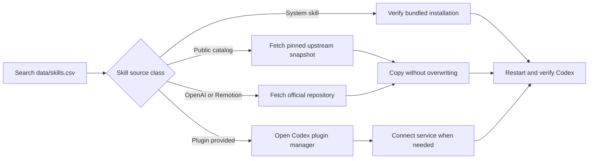

# Codex Skills Hub


<p align="center">
  
  
  
  
</p>

<p align="center">
  <strong>An attribution-first catalog and safe installer for a large Codex skill ecosystem.</strong>
</p>

Codex Skills Hub makes a collection of **985 skill names** searchable, reproducible, and easier to install without pretending that upstream work belongs to this repository. It combines a pinned public catalog, official Codex skills, external specialist skills, and plugin-managed capabilities in one provenance-aware index.

> This repository catalogs and installs skills from their original sources. It does **not** republish third-party skill code or credentials.

## Why this project exists

Agent skills are powerful, but large collections quickly become difficult to audit. Codex Skills Hub adds the missing organization layer:

- **Discoverability** — one normalized catalog with 985 unique names.
- **Provenance** — every public skill points to its upstream source.
- **Reproducibility** — the 880-skill public catalog is pinned to a verified commit.
- **Safety** — installers never overwrite an existing skill unless explicitly requested.
- **Honest ownership** — plugin-managed and third-party capabilities remain attributed to their maintainers.
- **Validation** — CI checks catalog structure, counts, duplicates, and source metadata.

## Catalog snapshot

| Source class | Count | How it is handled |
|---|---:|---|
| Public catalog | 880 | Installable from the pinned Composio Community snapshot |
| Plugin-provided | 100 | Enabled through the Codex plugin manager |
| Codex system | 3 | Verified as bundled capabilities |
| Separately sourced | 2 | Installed from OpenAI Skills and Remotion |
| **Total unique names** | **985** | Indexed in [`data/skills.csv`](data/skills.csv) |

## Quick start

### 1. Clone the hub

```powershell
git clone https://github.com/YassinDhibi/codex-skills-hub.git
cd codex-skills-hub
```

### 2. Search the catalog

```powershell
Import-Csv .\data\skills.csv |
  Where-Object { $_.name -match "github|security|spreadsheet" } |
  Format-Table name, kind, plugin
```

### 3. Preview an installation

```powershell
.\scripts\install.ps1 -Name ahrefs-automation -DryRun
```

### 4. Install one or more public skills

```powershell
.\scripts\install.ps1 -Name ahrefs-automation,content-research-writer
```

Install every skill from the pinned 880-skill public catalog:

```powershell
.\scripts\install.ps1 -AllPublic
```

The default destination is `$CODEX_HOME\skills`, or `%USERPROFILE%\.codex\skills` when `CODEX_HOME` is unset.

## How it works



## Reproducible public snapshot

The public catalog was verified against:

- Repository: [`composio-community/awesome-codex-skills`](https://github.com/composio-community/awesome-codex-skills)
- Commit: [`0930e1373789d2eda449039f7ac154b33031de89`](https://github.com/composio-community/awesome-codex-skills/tree/0930e1373789d2eda449039f7ac154b33031de89)
- Matching local skill definitions: **880**

Pinning the commit prevents the meaning of an old catalog snapshot from changing silently.

## Safety model

The installer follows conservative defaults:

1. Existing destination folders are skipped.
2. Plugin skills are reported instead of copied from cache directories.
3. Account connections are never transferred or requested in bulk.
4. Temporary clones are isolated and removed after the operation.
5. Every copied skill must contain a readable `SKILL.md`.
6. The repository contains no passwords, cookies, tokens, or private memories.

Review a skill's `SKILL.md`, scripts, license, and requested integrations before using it.

## Repository structure

```text
codex-skills-hub/
├── .github/workflows/validate.yml
├── assets/codex-skills-hub-hero.jpg
├── data/skills.csv
├── scripts/install.ps1
├── scripts/validate_catalog.py
├── CONTRIBUTING.md
├── LICENSE
├── NOTICE.md
├── SECURITY.md
└── README.md
```

## Validation

Run the local catalog checks:

```powershell
python .\scripts\validate_catalog.py
```

The validator checks the expected 985 unique names, category totals, required columns, duplicate names, and missing provenance.

## Contributing

Contributions are welcome. A catalog entry should include:

- a unique skill name;
- the correct source class;
- a public upstream URL when one exists;
- the plugin name for plugin-managed skills;
- no copied secrets or account-specific configuration.

See [`CONTRIBUTING.md`](CONTRIBUTING.md) before opening a pull request.

## Attribution and licensing

The original scripts, documentation, catalog organization, and generated hero artwork in this repository are released under the MIT License. Third-party skills remain governed by their upstream repositories and licenses. See [`NOTICE.md`](NOTICE.md).

## Author

Created and maintained by **Yassin DHIBI** — [@YassinDhibi](https://github.com/YassinDhibi).

If this hub helps your workflow, consider starring the repository and contributing a verified source entry.

